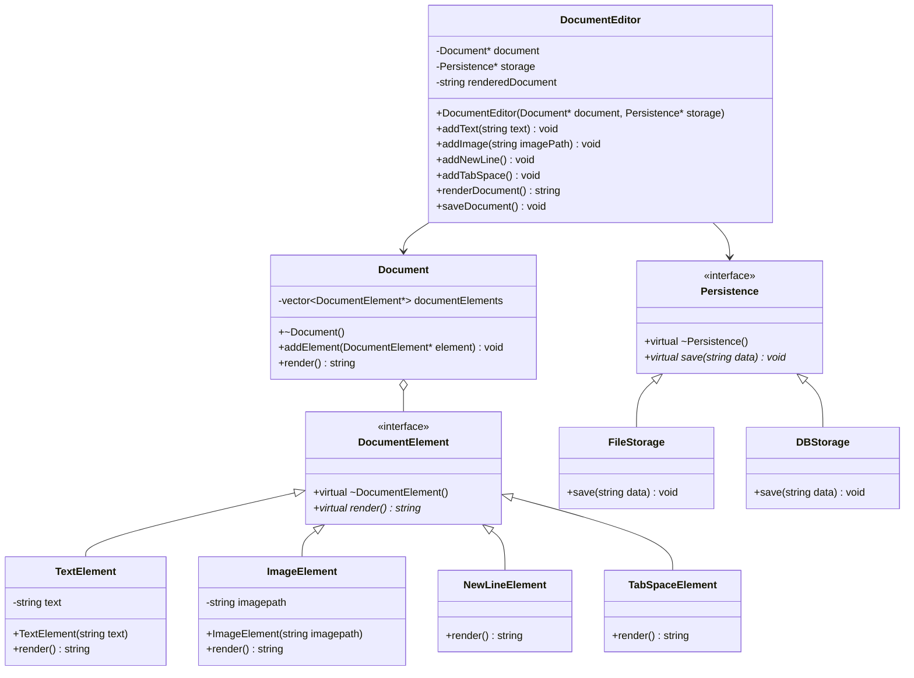

# Document Editor

An extensible, object-oriented Document Editor implemented in C++ following all five **SOLID** design principles. The system allows constructing and formatting documents with heterogeneous elements (text, images, indentation, line breaks) and persisting them to multiple storage backends without tight coupling.

---

## Table of Contents

- [Overview](#overview)
- [SOLID Principles Implementation](#solid-principles-implementation)
- [Architecture & Class Diagram](#architecture--class-diagram)
- [Project Structure](#project-structure)
- [Getting Started](#getting-started)
  - [Prerequisites](#prerequisites)
  - [Compilation](#compilation)
  - [Running the Application](#running-the-application)
- [Sample Output](#sample-output)
- [Extensibility Guide](#extensibility-guide)
- [License](#license)

---

## Overview

The Document Editor provides a modular architecture for building and rendering compound documents:
- **Modular Elements**: Supports various content types such as plain text, formatted indentation (tabs), line breaks, and image placeholders.
- **Pluggable Persistence**: Decouples document representation from storage mechanisms (e.g., local file system, relational database, or cloud storage).
- **Clean API**: Offers a high-level `DocumentEditor` interface for client operations while keeping internal document structure extensible.

---

## SOLID Principles Implementation

This project was built to illustrate and adhere to each of the 5 SOLID design principles:

### 1. Single Responsibility Principle (SRP)
> *A class should have one, and only one, reason to change.*

- **`DocumentElement` hierarchy (`TextElement`, `ImageElement`, `NewLineElement`, `TabSpaceElement`)**: Each element is strictly responsible for rendering its specific representation.
- **`Document`**: Solely responsible for aggregating document elements and concatenating their rendered outputs into a complete document.
- **`Persistence` (`FileStorage`, `DBStorage`)**: Exclusively responsible for saving document data to specific storage media.
- **`DocumentEditor`**: Responsible for mediating client interactions and orchestrating the document editing and saving workflows.

### 2. Open/Closed Principle (OCP)
> *Software entities should be open for extension, but closed for modification.*

- **Adding new elements**: New document elements (such as `HeaderElement`, `TableElement`, or `QuoteElement`) can be added by creating a new class deriving from `DocumentElement` without modifying existing element classes or `Document`.
- **Adding new storage types**: New storage targets (such as `CloudStorage` or `NetworkStorage`) can be introduced by implementing the `Persistence` interface without altering `DocumentEditor`.

### 3. Liskov Substitution Principle (LSP)
> *Derived classes must be substitutable for their base classes without altering program correctness.*

- Any class derived from `DocumentElement` can be passed into `Document::addElement(DocumentElement*)` and rendered polymorphically through `render()` without unexpected side effects or type inspections (`dynamic_cast` / `typeid`).
- Any implementation of `Persistence` (`FileStorage`, `DBStorage`, etc.) can be injected into `DocumentEditor` without affecting how the editor functions.

### 4. Interface Segregation Principle (ISP)
> *Clients should not be forced to depend upon interfaces that they do not use.*

- `DocumentElement` exposes only the single, focused method required for rendering (`render()`).
- `Persistence` exposes only the single contract required for saving data (`save(string data)`).
- Interfaces are minimal, cohesive, and avoid forcing unrelated behaviors onto implementing classes.

### 5. Dependency Inversion Principle (DIP)
> *High-level modules should not depend on low-level modules; both should depend on abstractions.*

- `DocumentEditor` (high-level client module) does not instantiate or directly depend on concrete storage mechanisms like `FileStorage`. Instead, it depends on the abstract `Persistence` interface injected via its constructor.
- `Document` depends on the abstract `DocumentElement` base class rather than concrete element types.

---

## Architecture & Class Diagram



---

## Project Structure

```
document_editor/
├── main.cpp        # Source code containing all interfaces, implementations, and usage demo
├── .gitignore      # Git ignore rules for build artifacts and temporary files
└── README.md       # Project overview, SOLID analysis, and instructions
```

---

## Getting Started

### Prerequisites

- A C++ compiler supporting **C++17** or newer:
  - GCC (`g++`) 7.0+
  - Clang (`clang++`) 5.0+
  - MSVC (Visual Studio 2017+)

### Compilation

Clone the repository and compile using `g++`:

```bash
git clone https://github.com/pkppwe23-sketch/document_editor.git
cd document_editor
g++ -std=c++17 -Wall -Wextra main.cpp -o document_editor
```

### Running the Application

**On Windows (PowerShell / Command Prompt):**
```powershell
.\document_editor.exe
```

**On Linux / macOS:**
```bash
./document_editor
```

---

## Sample Output

When executed, the program produces the following console output:

```text
Hello, world!
This is a real-world document editor example.
	Indented text after a tab space.
[Image:picture.jpg]
Document saved to document.txt
```

Additionally, `document.txt` will be created in the current working directory containing the formatted document content.

---

## Extensibility Guide

### Adding a Header Element
To add a markdown-style header, simply create a new subclass of `DocumentElement`:

```cpp
class HeaderElement : public DocumentElement {
private:
    int level;
    std::string text;
public:
    HeaderElement(int level, std::string text) : level(level), text(text) {}

    std::string render() override {
        return std::string(level, '#') + " " + text + "\n";
    }
};
```

### Adding a New Storage Target
To add a cloud or JSON storage provider, implement `Persistence`:

```cpp
class CloudStorage : public Persistence {
public:
    void save(std::string data) override {
        // Upload data to cloud bucket / REST endpoint
        std::cout << "Document successfully uploaded to Cloud storage." << std::endl;
    }
};
```

---

## License

This project is licensed under the MIT License - see the LICENSE file for details.
